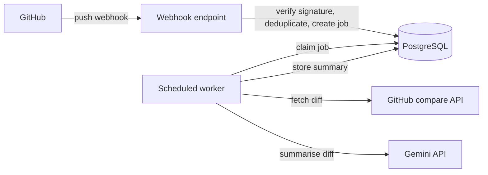
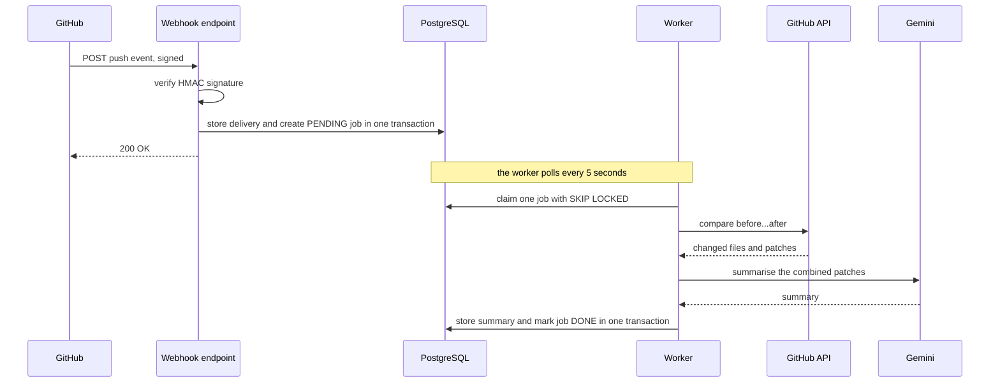
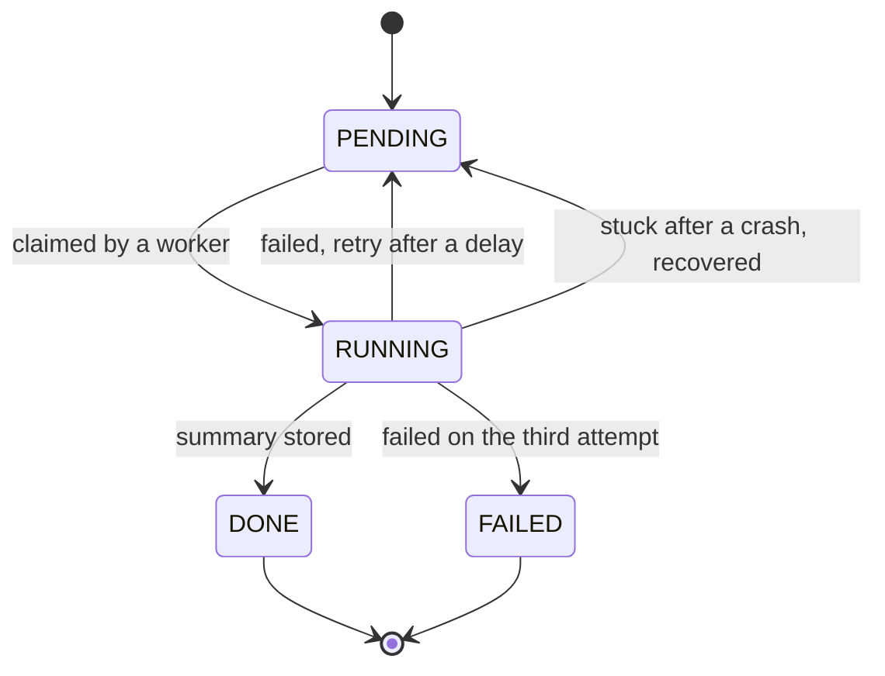

# Ripple

Ripple turns every GitHub push into a short, plain-language summary of what changed. It receives the push webhook, fetches the real diff from GitHub, asks an LLM to summarise it, and stores the result in PostgreSQL. It is built as a background-job system, so the webhook answers GitHub immediately and the slow work happens in a worker.

This is a personal backend project. It is a work in progress, and the roadmap at the bottom shows where it is heading: a chatbot that answers questions about a repository's history, and later an impact analysis of each change.

## Example

Push a small commit to a connected repository and, about half a minute later, a row like this appears in the database. This one came from a test repository:

> Getter and setter methods have been added to the `Book` class for the `title`, `author`, and `price` attributes, including validation in `setPrice` to prevent negative values. The `ConstructorDemo` driver class was also updated to demonstrate modifying and retrieving a book's price using these new methods. This change improves encapsulation and data integrity by allowing controlled, safe access to the object's fields after instantiation.

## Architecture



## How a push is processed



## Job lifecycle



## Design decisions

- **The webhook only records and queues.** GitHub expects a reply within seconds, so the endpoint verifies the signature, stores the delivery, creates a job, and returns. Fetching diffs and calling an LLM happen later in the worker.
- **Every request is authenticated.** Signatures are checked against the raw request body with a constant-time comparison before anything is parsed or stored. Invalid requests get a 401 and leave no trace in the database.
- **Duplicates are harmless.** GitHub's delivery id is unique in the database, so a redelivery or a simultaneous duplicate cannot create a second job.
- **Jobs are claimed safely.** Workers use `SELECT ... FOR UPDATE SKIP LOCKED`, so a job locked by one worker is skipped by the others. Claiming and finishing are short transactions, and no lock is held during network calls.
- **Failures are expected.** A failed job is retried with a growing delay and becomes `FAILED` after three attempts, keeping its error. A recovery task returns jobs that were left in `RUNNING` by a crash.
- **Results are all-or-nothing.** The summary and the `DONE` status are written in one transaction, so a job is never done without its summary.
- **The LLM is swappable.** The worker depends on a small `LlmClient` interface, and the model name is stored with each summary.

The table layouts and migration history are in [docs/DATABASE.md](docs/DATABASE.md).

## Getting started

### Prerequisites

- A JDK compatible with the version in `pom.xml`
- PostgreSQL with an empty database for Ripple
- ngrok or a similar tunnel to receive webhooks locally
- A GitHub fine-grained personal access token with read-only access to repository contents, limited to the repositories you want to read
- A Gemini API key from Google AI Studio

### Configuration

Connection settings are in `src/main/resources/application.properties`. Four secrets come from environment variables and have no defaults:

| Variable | Purpose |
|---|---|
| `DB_PASSWORD` | PostgreSQL password |
| `GITHUB_WEBHOOK_SECRET` | shared secret for verifying webhook signatures |
| `GITHUB_TOKEN` | token for reading diffs from the GitHub API |
| `GEMINI_API_KEY` | key for the Gemini API |

The model is set with the `gemini.model` property (currently `gemini-2.5-flash`).

On the free tier of the Gemini API, Google's terms allow submitted content to be used to improve its products. Use throwaway repositories while testing, and check the provider's data terms before connecting private code.

### Run

```bash
./mvnw spring-boot:run
```

Flyway applies the migrations on startup. The server listens on port 8080 and the worker starts polling.

### Connect a repository

1. Start a tunnel with `ngrok http 8080`.
2. In the repository settings, add a webhook with the payload URL `https://<your-tunnel-host>/api/webhooks/github`.
3. Set the content type to `application/json`, use your `GITHUB_WEBHOOK_SECRET` as the secret, and select the push event only.
4. Push a commit.

The application log shows the push, the diff being fetched, and the summary. To read the stored results:

```sql
SELECT repo_full_name, status, attempts, finished_at
FROM analysis_jobs ORDER BY created_at DESC LIMIT 5;

SELECT job_id, model, summary
FROM change_summaries ORDER BY created_at DESC LIMIT 5;
```

## Verified behaviour

These cases were tested manually against a real repository:

- A push creates one delivery and one pending job.
- Redelivering a push adds nothing.
- An invalid or missing signature returns 401 and stores nothing.
- A failure while saving rolls back everything, and a later redelivery succeeds.
- The worker fetches the diff, stores a Gemini summary with the model name, and the job ends `DONE`.
- A forced failure goes through three attempts with growing delays and ends `FAILED` with the error kept.
- Jobs left in `RUNNING` by an earlier run are recovered and processed.

Testing with several workers at once, and automated integration tests, are still to do.

## Tech stack

Java, Spring Boot (Web, Data JPA, Validation, Actuator, scheduling), PostgreSQL, Flyway, Spring `RestClient`, Google Gemini API, Lombok, Maven.

## Project layout

```
org.personal.ripple
  controller    HTTP endpoints
  services      webhook handling, job claiming, scheduled worker, summary storage
  entity        JPA entities and enums
  repository    Spring Data repositories
  security      signature verification
  github        GitHub API client and response records
  llm           LlmClient interface and the Gemini implementation
```

## Known limitations

- Each push is summarised with one LLM call over the combined patches. Very large pushes are not split or truncated yet.
- Branch creation and deletion pushes are not special-cased.
- Scheduled tasks share one thread, so a slow LLM call delays the next poll.
- The GitHub token is a personal access token. A GitHub App with installation tokens is planned.

## Roadmap

1. Retrieval and chat: embed summaries, diffs, and commit messages with pgvector, and add a repository-scoped chat endpoint that cites the commits and files it used and declines questions it has no evidence for. A command-line client will call it.
2. Index the full repository once when it is connected, so questions can cover code that has not changed since the webhook was added.
3. Post the summary back to GitHub as a comment.
4. Move to a GitHub App with installation tokens.
5. Impact analysis for Java code using a dependency graph built from the source.
6. Hardening: Kafka in place of the job table, Redis, Testcontainers tests including concurrent workers, load tests, metrics.