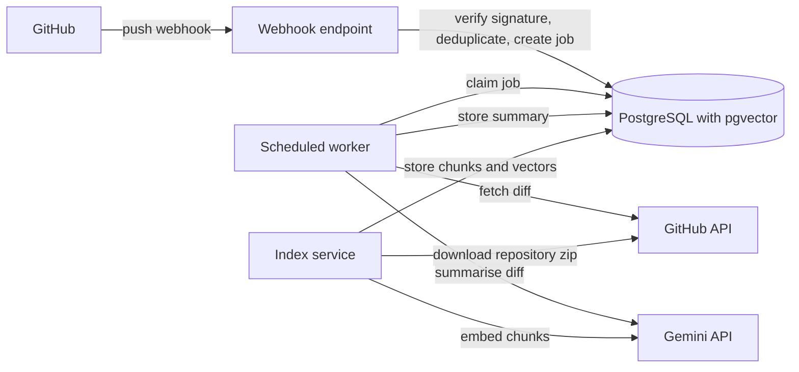
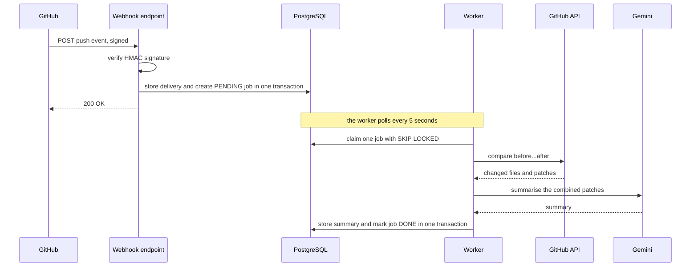
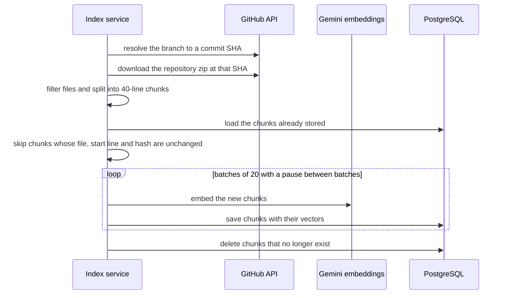
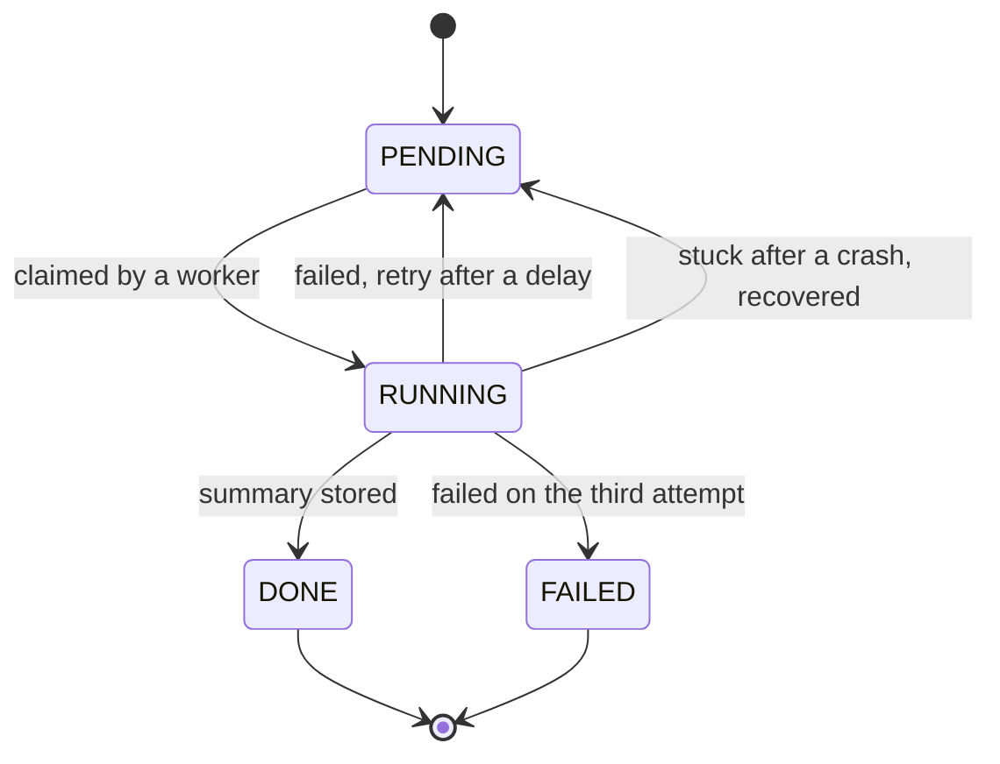

# Ripple

Ripple keeps the context of a code repository, so you do not have to explain it to an LLM again every time. It turns every GitHub push into a short, plain-language summary, and it indexes the repository's code as vectors for retrieval. The goal is a chat that finds the few chunks of code that matter for a question, instead of making a model read the whole codebase on every request.

It is a personal backend project, built with Java and Spring Boot, and it is a work in progress. The roadmap at the bottom shows what is next.

## Example

Push a small commit to a connected repository and, about half a minute later, a summary like this appears in the database. This one came from a test repository:

> Getter and setter methods have been added to the `Book` class for the `title`, `author`, and `price` attributes, including validation in `setPrice` to prevent negative values. The `ConstructorDemo` driver class was also updated to demonstrate modifying and retrieving a book's price using these new methods. This change improves encapsulation and data integrity by allowing controlled, safe access to the object's fields after instantiation.

Searching the indexed code works by meaning. On Ripple's own repository, the question "how are duplicate webhook deliveries handled?" returns the duplicate check in the webhook service, the exception handling in the controller, and the unique constraint in the first migration, even though the question shares almost no words with that code.

## Architecture



## How a push is processed



## How a repository is indexed



## Job lifecycle



## Design decisions

- **The webhook only records and queues.** GitHub expects a reply within seconds, so the endpoint verifies the signature, stores the delivery, creates a job, and returns. Fetching diffs and calling an LLM happen later in the worker.
- **Every request is authenticated.** Signatures are checked against the raw request body with a constant-time comparison before anything is parsed or stored. Invalid requests get a 401 and leave no trace in the database.
- **Duplicates are harmless.** GitHub's delivery id is unique in the database, so a redelivery or a simultaneous duplicate cannot create a second job.
- **Jobs are claimed safely.** Workers use `SELECT ... FOR UPDATE SKIP LOCKED`, so a job locked by one worker is skipped by the others. Claiming and finishing are short transactions, and no lock is held during network calls.
- **Failures are expected.** A failed job is retried with a growing delay and becomes `FAILED` after three attempts, keeping its error. A recovery task returns jobs that were left in `RUNNING` by a crash.
- **Results are all-or-nothing.** The summary and the `DONE` status are written in one transaction, so a job is never done without its summary.
- **Indexing is incremental.** Each chunk is stored with a hash of its text. When a repository is indexed again, chunks whose file, position and hash are unchanged are not embedded again, and chunks that no longer exist are removed. A run that stops partway resumes with only what is left.
- **Indexing never holds a transaction open.** Embedding takes minutes because of API rate limits, so each batch is saved in its own short transaction.
- **Every search is scoped to one repository.** The vector query filters by repository before ranking, so one project's code cannot appear in another's results.
- **The models are swappable.** The worker depends on a small `LlmClient` interface and indexing on an `EmbeddingClient` interface. The model name is stored with each summary.

The table layouts and migration history are in [docs/DATABASE.md](docs/DATABASE.md).

## Getting started

### Prerequisites

- A JDK compatible with the version in `pom.xml`
- PostgreSQL with the pgvector extension installed, and an empty database for Ripple
- ngrok or a similar tunnel to receive webhooks locally
- A GitHub fine-grained personal access token with read-only access to repository contents, limited to the repositories you want to read
- A Gemini API key from Google AI Studio

### Configuration

Connection settings are in `src/main/resources/application.properties`. Four secrets come from environment variables and have no defaults:

| Variable | Purpose |
|---|---|
| `DB_PASSWORD` | PostgreSQL password |
| `GITHUB_WEBHOOK_SECRET` | shared secret for verifying webhook signatures |
| `GITHUB_TOKEN` | token for reading diffs and repository contents from the GitHub API |
| `GEMINI_API_KEY` | key for the Gemini API |

The models are set with properties: `gemini.model` for summaries (currently `gemini-2.5-flash`), `gemini.embedding-model` for embeddings (currently `gemini-embedding-001`), and `gemini.embedding-dimensions`, which must match the vector column size (768).

On the free tier of the Gemini API, Google's terms allow submitted content to be used to improve its products. Use public or throwaway repositories while testing, and check the provider's data terms before connecting private code.

### Run

```bash
./mvnw spring-boot:run
```

Flyway applies the migrations on startup. The server listens on port 8080 and the worker starts polling.

### Connect a repository

1. Start a tunnel with `ngrok http 8080`.
2. In the repository settings, add a webhook with the payload URL `https://<your-tunnel-host>/api/webhooks/github`.
3. Set the content type to `application/json`, use your `GITHUB_WEBHOOK_SECRET` as the secret, and select the push event only.
4. Push a commit.

The application log shows the push, the diff being fetched, and the summary. To read the stored results:

```sql
SELECT repo_full_name, status, attempts, finished_at
FROM analysis_jobs ORDER BY created_at DESC LIMIT 5;

SELECT job_id, model, summary
FROM change_summaries ORDER BY created_at DESC LIMIT 5;

SELECT repo_full_name, count(*) FROM code_chunks GROUP BY repo_full_name;
```

## Verified behaviour

These cases were tested manually against real repositories:

- A push creates one delivery and one pending job.
- Redelivering a push adds nothing.
- An invalid or missing signature returns 401 and stores nothing.
- A failure while saving rolls back everything, and a later redelivery succeeds.
- The worker fetches the diff, stores a Gemini summary with the model name, and the job ends `DONE`.
- A forced failure goes through three attempts with growing delays and ends `FAILED` with the error kept.
- Jobs left in `RUNNING` by an earlier run are recovered and processed.
- Indexing Ripple's own repository stores about 60 chunks with embeddings, and a natural-language question returns the relevant code.
- Indexing the same commit a second time embeds nothing and finishes in seconds.

Removal of outdated chunks, testing with several workers at once, and automated integration tests are still to do.

## Known limitations

- Indexing is started from code for now. An endpoint to trigger it and a table to track indexed repositories are the next step.
- Code is split into fixed windows of 40 lines with a 5-line overlap. Splitting by class and method is planned.
- Only common source and text files are indexed. Configuration files such as `.properties` and `.yml` are skipped on purpose, because they often contain secrets. Very large and binary files are skipped too.
- A repository of more than 2,000 chunks is refused.
- Indexing speed is limited by the embedding API's rate limits, so it pauses between batches. About 60 chunks take around a minute.
- Each push is summarised with one LLM call over the combined patches. Very large pushes are not split or truncated yet.
- Branch creation and deletion pushes are not special-cased.
- Scheduled tasks share one thread, so a slow LLM call delays the next poll.
- The GitHub token is a personal access token, so only public repositories or ones the token can read work. A GitHub App with installation tokens is planned.

## Tech stack

Java, Spring Boot (Web, Data JPA, Validation, Actuator, scheduling), PostgreSQL with pgvector, Flyway, Spring `RestClient`, Google Gemini API (summaries and embeddings), Lombok, Maven.

## Project layout

```
org.personal.ripple
  controller    HTTP endpoints
  services      webhook handling, job claiming, scheduled worker, summary storage, indexing
  entity        JPA entities and enums
  repository    Spring Data repositories
  security      signature verification
  github        GitHub API client, zip reader, chunker, hashing, response records
  llm           LlmClient and EmbeddingClient interfaces and their Gemini implementations
```

## Roadmap

1. Track repositories in a table and add an endpoint that starts indexing in the background.
2. Keep the index current on every push, re-embedding only the files that changed, and store the commit list with its messages.
3. Chat: embed the question, retrieve the closest chunks for that repository above a relevance cutoff, and answer with citations to files, line numbers, and commits. It should say it has no information when nothing relevant comes back. A command-line client will call it, with conversation history for follow-up questions.
4. Make it usable by a small group: deployment, users with API keys and an ownership check on every request, a webhook secret per repository, and limits on repository size and request rate.
5. Splitting code by class and method, keyword search combined with vector search, and impact analysis for Java code.
6. Move to a GitHub App with installation tokens, and post summaries back to GitHub as comments.
7. Hardening: Kafka in place of the job table, Redis, Testcontainers tests including concurrent workers, load tests, metrics.