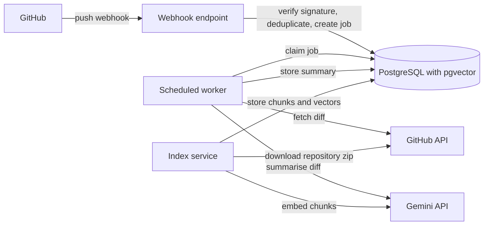
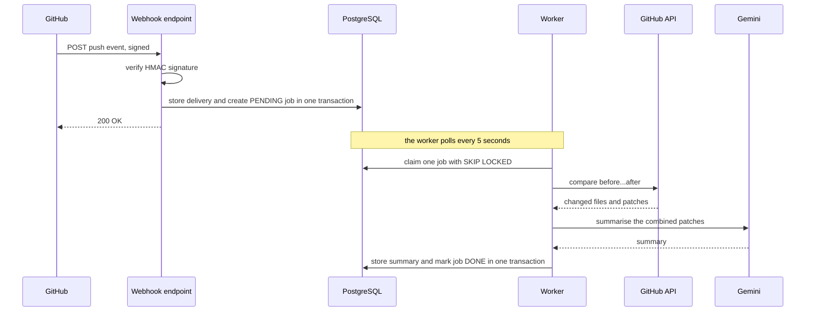
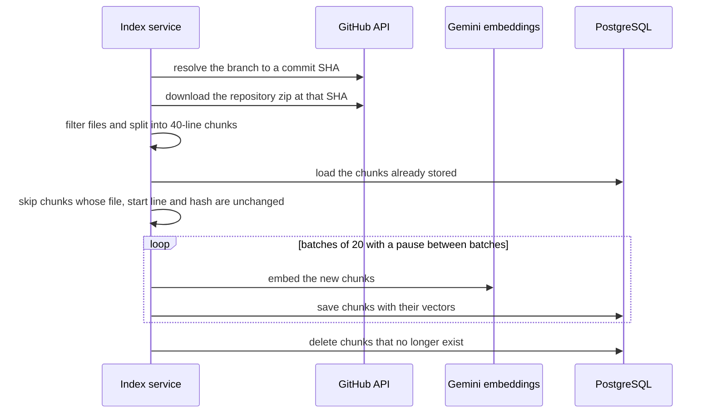
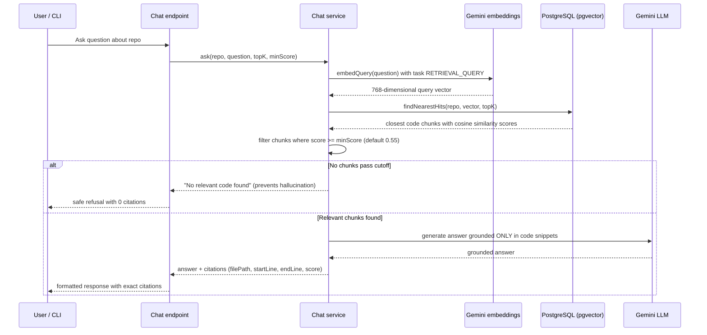
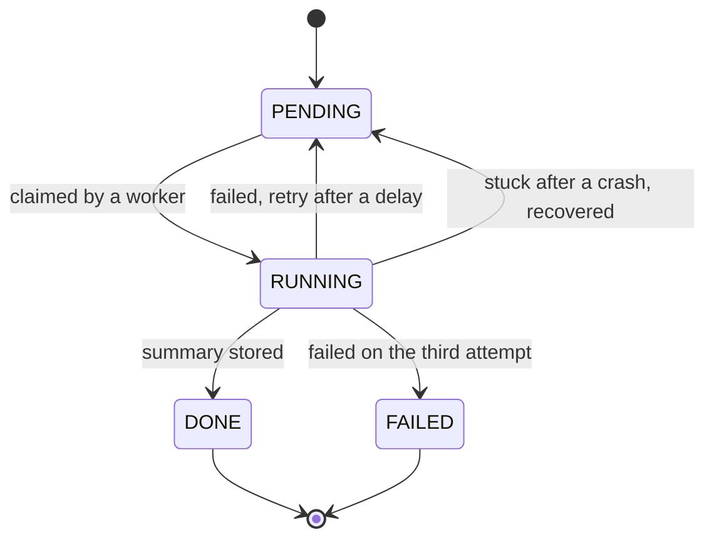

# Ripple

[](https://ripple-slke.onrender.com/actuator/health)
[](https://openjdk.org/)
[](https://spring.io/projects/spring-boot)
[](https://github.com/pgvector/pgvector)
[](https://ai.google.dev/)

> **Live Deployment:** [https://ripple-slke.onrender.com](https://ripple-slke.onrender.com)  
> **Health Endpoint:** [https://ripple-slke.onrender.com/actuator/health](https://ripple-slke.onrender.com/actuator/health)

Ripple is an automated repository intelligence and semantic code-retrieval (RAG) platform. It keeps continuous track of a code repository so you never have to re-explain your codebase or manually copy-paste hundreds of lines into an LLM again.

Ripple bridges your GitHub repositories with LLMs in two core ways:
1. **Automated Commit Summaries**: Listens to GitHub push webhooks, calculates git diffs, and generates plain-language, high-level summaries of what changed and why it matters.
2. **Semantic Code Search & Chat (RAG)**: Indexes codebase files into overlapping semantic chunks, generates vector embeddings using Gemini, stores them in PostgreSQL (`pgvector`), and powers an interactive grounded chat that cites exact file paths and line ranges.

---

## The Problem Ripple Solves (And How I Encountered It)

### The Problem
Working with LLMs on real-world software projects is filled with friction:
- **Context Window Bloat & Cost**: Dumping an entire project or huge source files into an LLM quickly exhausts token limits, increases API costs, and causes the model to suffer from "lost-in-the-middle" attention degradation.
- **Hallucinations**: When an LLM lacks exact, ground-truth context about your class hierarchies, helper methods, or validation logic, it invents plausible-sounding methods that don't exist.
- **Fast-Moving Codebases**: Codebases change on every push. Explaining yesterday's refactor or updated dependencies to a chat prompt over and over is tedious and error-prone.

### How I Encountered It
As a developer actively building and maintaining backend applications, I constantly found myself repeating the same manual loop:
1. I’d make changes or refactor an architecture, then switch to an AI tool to brainstorm or debug.
2. I’d have to manually copy-paste five different files into the prompt just to give the model the context it needed.
3. Every time someone pushed code to GitHub, the AI's mental model was immediately outdated.

I asked myself: **Why can't an AI assistant automatically stay in sync with my GitHub repository, know what changed on every push, and dynamically pull in only the 3 or 4 exact code snippets needed to answer any question?**

That frustration led to the creation of **Ripple**.

---

## Example

Push a small commit to a connected repository and, about half a minute later, a summary like this appears in the database. This one came from a test repository:

> Getter and setter methods have been added to the `Book` class for the `title`, `author`, and `price` attributes, including validation in `setPrice` to prevent negative values. The `ConstructorDemo` driver class was also updated to demonstrate modifying and retrieving a book's price using these new methods. This change improves encapsulation and data integrity by allowing controlled, safe access to the object's fields after instantiation.

Searching the indexed code works by meaning. On Ripple's own repository, the question "how are duplicate webhook deliveries handled?" returns the duplicate check in the webhook service, the exception handling in the controller, and the unique constraint in the first migration, even though the question shares almost no words with that code.

## Architecture



## How a push is processed



## How a repository is indexed



## How Chat & Semantic Retrieval Works (RAG)



## Job lifecycle



## Design decisions

- **The webhook only records and queues.** GitHub expects a reply within seconds, so the endpoint verifies the signature, stores the delivery, creates a job, and returns. Fetching diffs and calling an LLM happen later in the worker.
- **Every request is authenticated.** Signatures are checked against the raw request body with a constant-time comparison before anything is parsed or stored. Invalid requests get a 401 and leave no trace in the database.
- **Duplicates are harmless.** GitHub's delivery id is unique in the database, so a redelivery or a simultaneous duplicate cannot create a second job.
- **Jobs are claimed safely.** Workers use `SELECT ... FOR UPDATE SKIP LOCKED`, so a job locked by one worker is skipped by the others. Claiming and finishing are short transactions, and no lock is held during network calls.
- **Failures are expected.** A failed job is retried with a growing delay and becomes `FAILED` after three attempts, keeping its error. A recovery task returns jobs that were left in `RUNNING` by a crash.
- **Results are all-or-nothing.** The summary and the `DONE` status are written in one transaction, so a job is never done without its summary.
- **Indexing is incremental.** Each chunk is stored with a hash of its text. When a repository is indexed again, chunks whose file, position and hash are unchanged are not embedded again, and chunks that no longer exist are removed. A run that stops partway resumes with only what is left.
- **Indexing never holds a transaction open.** Embedding takes minutes because of API rate limits, so each batch is saved in its own short transaction.
- **Every search is scoped to one repository.** The vector query filters by repository before ranking, so one project's code cannot appear in another's results.
- **The models are swappable.** The worker depends on a small `LlmClient` interface and indexing on an `EmbeddingClient` interface. The model name is stored with each summary.

The table layouts and migration history are in [docs/DATABASE.md](docs/DATABASE.md).

## Getting started

### Prerequisites

- A JDK compatible with the version in `pom.xml`
- PostgreSQL with the pgvector extension installed, and an empty database for Ripple
- ngrok or a similar tunnel to receive webhooks locally
- A GitHub fine-grained personal access token with read-only access to repository contents, limited to the repositories you want to read
- A Gemini API key from Google AI Studio

### Configuration

Connection settings are in `src/main/resources/application.properties`. Four secrets come from environment variables and have no defaults:

| Variable | Purpose |
|---|---|
| `DB_PASSWORD` | PostgreSQL password |
| `GITHUB_WEBHOOK_SECRET` | shared secret for verifying webhook signatures |
| `GITHUB_TOKEN` | token for reading diffs and repository contents from the GitHub API |
| `GEMINI_API_KEY` | key for the Gemini API |

The models are set with properties: `gemini.model` for summaries (currently `gemini-3.5-flash-lite`), `gemini.embedding-model` for embeddings (currently `gemini-embedding-001`), and `gemini.embedding-dimensions`, which must match the vector column size (768).

On the free tier of the Gemini API, Google's terms allow submitted content to be used to improve its products. Use public or throwaway repositories while testing, and check the provider's data terms before connecting private code.

### Run

```bash
./mvnw spring-boot:run
```

Flyway applies the migrations on startup. The server listens on port 8080 and the worker starts polling.

### Connect a repository

1. In your GitHub repository settings, go to **Webhooks** $\to$ **Add webhook**.
2. Set the **Payload URL**:
   * **Live Render Deployment:** `https://ripple-slke.onrender.com/api/webhooks/github`
   * **Or Local Testing:** Start a tunnel (`ngrok http 8080`) and use `https://<your-tunnel-host>/api/webhooks/github`
3. Set the content type to `application/json`.
4. Set the secret to your `GITHUB_WEBHOOK_SECRET`.
5. Select **Just the push event**.
6. Push a commit to your repository.

The application automatically verifies the HMAC signature, fetches the diff from GitHub, generates a summary using Gemini Flash, and marks the job done:

```sql
SELECT repo_full_name, status, attempts, finished_at
FROM analysis_jobs ORDER BY created_at DESC LIMIT 5;

SELECT job_id, model, summary
FROM change_summaries ORDER BY created_at DESC LIMIT 5;

SELECT repo_full_name, count(*) FROM code_chunks GROUP BY repo_full_name;
```

### Ask questions about a repository (Chat)

#### Option 1: Interactive CLI Tool (Recommended)

Ripple includes an interactive terminal chat client.

**Connect to the live cloud deployment:**
```bash
# Windows
set RIPPLE_SERVER_URL=https://ripple-slke.onrender.com
.\chat.cmd mzaidiii/Ripple

# Linux / macOS
RIPPLE_SERVER_URL=https://ripple-slke.onrender.com ./chat.sh mzaidiii/Ripple
```

**Or connect to a local server (`http://localhost:8080`):**
```bash
# Windows
.\chat.cmd mzaidiii/Ripple

# Linux / macOS
./chat.sh mzaidiii/Ripple
```

The CLI automatically verifies repository status, prompts to trigger indexing if needed, and starts an interactive session:

```text
============================================================
               R I P P L E   C H A T   C L I
     Semantic Codebase Intelligence & Retrieval (RAG)
============================================================

[✓] Repository status: READY (SHA: 4f1a8c9)
Ready! Ask any question about mzaidiii/Ripple.

[mzaidiii/Ripple] > How are duplicate webhook deliveries handled?
Searching code chunks & generating grounded answer...

──────────────────────────────────────────────────────────────────────
Answer (gemini-3.5-flash-lite):
──────────────────────────────────────────────────────────────────────
Duplicate webhook deliveries are handled primarily in WebhookService.java...

Citations (2 references):
  [1] src/main/java/org/personal/ripple/services/WebhookService.java:26-64 (similarity: 0.884)
      "if (webRepo.existsByDeliveryId(deliveryId)) {"
  [2] src/main/java/org/personal/ripple/controller/WebhookController.java:30-54 (similarity: 0.792)
      "try { webhookService.handlePush(deliveryID,payload);"
──────────────────────────────────────────────────────────────────────
```

Commands inside CLI:
- `:status` - Check indexing status and commit SHA
- `:index` - Trigger background re-indexing
- `:topk <n>` - Set number of code chunks to retrieve (default: 5)
- `:minscore <f>` - Set minimum similarity cutoff (default: 0.55)
- `exit` or `quit` - Exit

#### Option 2: REST API

Send a `POST` request to `/api/repos/<owner>/<repo>/chat`:

```bash
# Live Cloud API
curl -X POST https://ripple-slke.onrender.com/api/repos/mzaidiii/Ripple/chat \
  -H "Content-Type: application/json" \
  -d '{
    "question": "How are duplicate webhook deliveries handled?",
    "topK": 5,
    "minScore": 0.55
  }'

# Or Local API (http://localhost:8080/api/repos/<owner>/<repo>/chat)
```

Response format:

```json
{
  "answer": "Duplicate webhook deliveries are handled primarily in WebhookService.java:29-32...",
  "citations": [
    {
      "filePath": "src/main/java/org/personal/ripple/services/WebhookService.java",
      "startLine": 20,
      "endLine": 45,
      "score": 0.884,
      "snippetPreview": "if (webRepo.existsByDeliveryId(deliveryId)) {..."
    }
  ],
  "model": "gemini-3.5-flash-lite",
  "contextFound": true
}
```

If no code chunks meet the confidence cutoff threshold, the API informs you instead of hallucinating.

## Verified behaviour

These cases were tested manually against real repositories:

- A push creates one delivery and one pending job.
- Redelivering a push adds nothing.
- An invalid or missing signature returns 401 and stores nothing.
- A failure while saving rolls back everything, and a later redelivery succeeds.
- The worker fetches the diff, stores a Gemini summary with the model name, and the job ends `DONE`.
- A forced failure goes through three attempts with growing delays and ends `FAILED` with the error kept.
- Jobs left in `RUNNING` by an earlier run are recovered and processed.
- Indexing Ripple's own repository stores about 60 chunks with embeddings, and a natural-language question returns the relevant code.
- Indexing the same commit a second time embeds nothing and finishes in seconds.

Removal of outdated chunks, testing with several workers at once, and automated integration tests are still to do.

## Known limitations

- Code is split into fixed windows of 40 lines with a 5-line overlap. Splitting by class and method (AST-based) is planned.
- Only common source and text files are indexed. Configuration files such as `.properties` and `.yml` are skipped on purpose, because they often contain secrets. Very large and binary files are skipped too.
- A repository of more than 2,000 chunks is refused in a single indexing run.
- Indexing speed is paced to respect the embedding API's rate limits (batches of 20 with pauses).
- Each push is summarised with one LLM call over the combined patches. Very large pushes are not split or truncated yet.
- Scheduled tasks share one thread, so a slow LLM call delays the next poll.
- The GitHub token is a personal access token, so only public repositories or ones the token can read work. A GitHub App with installation tokens is planned for multi-tenant setups.

## Tech stack

Java 21, Spring Boot (Web, Data JPA, Validation, Actuator, scheduling), PostgreSQL with pgvector, Flyway, Spring `RestClient`, Google Gemini API (summaries and embeddings), Lombok, Maven.

## Project layout

```
org.personal.ripple
  cli           Interactive CLI chat client (RippleChatCli)
  controller    HTTP endpoints (RepoController, WebhookController, ChatController)
  dto           Request/Response DTOs and records (ChatRequest, ChatResponse, Citation)
  services      Webhook handling, job claiming, scheduled worker, summary storage, indexing, chat
  entity        JPA entities and enums (AnalysisJob, ChangeSummary, CodeChunk, TrackedRepo, etc.)
  repository    Spring Data repositories (CodeChunkRepository, AnalysisJobRepository, etc.)
  security      HMAC SHA-256 signature verification
  github        GitHub API client, zip reader, chunker, hashing, response records
  llm           LlmClient and EmbeddingClient interfaces and their Gemini implementations
```

## Milestone Status & Roadmap

### V1 — Core Platform (Completed ✓)
- [x] **Webhook Ingestion**: Fast asynchronous GitHub push receiver with HMAC SHA-256 signature verification and idempotency.
- [x] **Background Job Worker**: Concurrent-safe queue (`FOR UPDATE SKIP LOCKED`), retry backoff, and orphan job crash recovery.
- [x] **Automated Push Summaries**: Gemini-powered plain-language change summaries stored for every push.
- [x] **Repository Tracking & Indexing**: Database tracking (`tracked_repositories`), zip-based repository ingestion, SHA-256 chunk deduplication.
- [x] **Vector Storage (pgvector)**: 768-dimensional embeddings generated with `gemini-embedding-001` and cosine distance nearest-neighbor queries.
- [x] **Grounded RAG Chat Endpoint**: `POST /api/repos/{owner}/{repo}/chat` with relevance score cutoff (hallucination prevention), grounded prompt assembly, and exact file/line citations.
- [x] **Interactive CLI Chat Client**: `RippleChatCli` terminal client launched via `./chat.cmd` or `./chat.sh` with live repository status polling and commands.
- [x] **Cloud Production Deployment**: Containerized with Docker and live on Render with PostgreSQL (`pgvector`) at [https://ripple-slke.onrender.com](https://ripple-slke.onrender.com).

### V2 — Performance, Scale & Developer Experience (Next)
1. **Differential Indexing on Push**: Re-embed only the files modified in `CompareResult` instead of re-downloading the entire zipball.
2. **Postgres HNSW Vector Indexing**: Add `CREATE INDEX ... USING hnsw (embedding vector_cosine_ops)` to ensure sub-millisecond retrieval on large codebases.
3. **Multi-turn Conversation History**: Session memory allowing natural follow-up questions in the CLI and API.
4. **AST-Aware Semantic Chunking**: Split code by class and method boundaries using syntax tree parsing rather than fixed 40-line windows.
5. **Hybrid Search (BM25 + Vector)**: Combine Postgres full-text search with vector similarity for exact identifier and symbol lookups.
6. **GitHub App Comments**: Post change summaries directly back to GitHub PRs and commits as comments.

---

## About the Author

Hi! I'm **Mohamed Zaid** ([@mzaidiii](https://github.com/mzaidiii)).

I built **Ripple** out of a practical need to bridge LLMs with real-world, fast-evolving codebases without the friction of manual copy-pasting, bloated context windows, and hallucinations. I'm passionate about backend systems, distributed architectures, database internals, and building developer-first AI tools that solve everyday software engineering bottlenecks.

Feel free to star the repo, open an issue or PR, or connect with me on GitHub!
